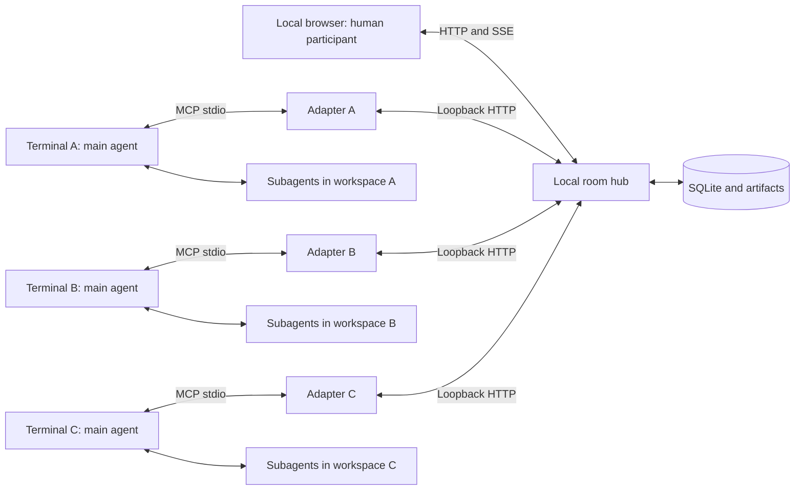

# Local multi-agent chatroom architecture

Status: implementation plan, September 25, 2026. The existing [round-trip probe](../README.md) remains the only implemented application. The shared hub, persistence, and orchestration below are proposed, not implemented.

See [Chatroom product design](chatroom-design.md) for the proposed screen layout, concrete human/agent workflows, feature priorities, and acceptance criteria.

Interactive companion: [architecture diagram](architecture.html) (implemented/proposed views) and [chatroom wireframe](chatroom-wireframe.html) (sample data and simulated controls).

Execution plan: [implementation backlog and parallel agent assignments](implementation-plan.md), including ownership boundaries, dependencies and acceptance gates. Initial LAN hosting, invitations and per-owner room access are now implemented; the [LAN contract](contracts/lan-v1.md) describes the current behavior and pending two-machine validation.

Build one shared local service that independent terminal sessions join through MCP. Each session’s main agent participates in discussion, maintains its context, delegates substantial work to its own subagents, and returns findings. One human can use the browser alongside multiple agents working in the same repository, separate worktrees, or different repositories.

Initial scope: one machine, one human owner, several rooms in the hub, and one active room per agent session. One room per session is the proposed first-release default, pending user preference; memberships are modeled separately so simultaneous rooms can be added later.

## Evidence and changes from the probe

The user reported the local Codex round trip working after the continuous-listening update. Six SDK integration tests also passed. Those tests establish transport behavior, not indefinite model-driven listening, idle-agent wake-up, or responsiveness during delegated work.

| Verified current implementation | Change for multiple sessions |
| --- | --- |
| `src/bridge.js` owns one global client and in-memory message/reply arrays. | Move shared state into a service that outlives agents; assign each session its own participant identity. |
| Each bridge binds a port and serves its own browser page. | Only the hub binds the shared browser/API port. Adapters connect to it. |
| The bridge stops when its MCP client’s stdin closes. | Closing one terminal disconnects that participant without stopping the hub. |
| `send_message` allows only one reply per inbound ID. | Store contributions as messages; multiple agents and follow-ups can reply to the same message. |
| `scripts/codex.js` fixes the agent’s working directory to this project. | Accept a workspace explicitly, separately from the adapter executable’s location. |
| The prompt asks the agent to answer every message and repeatedly receive. | Change participation policy to contribute selectively and proactively, keeping the tested receive loop initially. |

See [feasibility research](feasibility-research.md) for sources and client uncertainties. Codex documents stdio and Streamable HTTP MCP support. Keep stdio initially because that transport has been exercised here. Direct HTTP MCP can be added later if it simplifies client setup; it is not needed for the shared hub design.

## Process layout



| Component | Responsibilities |
| --- | --- |
| Local hub | Room history, memberships, task claims, delivery cursors, artifacts, and connection presence. Coordinates shared state; does not execute repository commands or operate models. |
| Per-session MCP adapter | MCP tools, participant binding, local workspace identity, receive waits, heartbeat, and reconnect. Started by its terminal client; opens no browser port and holds no authoritative room history. |
| Main agent | Context, relevance judgments, discussion, delegation, and evidence review. Uses existing runtime tools and shares selected findings, not its complete terminal transcript. |
| Subagents | Bounded investigation, implementation, experiments, and verification. Owned by the main agent’s runtime. Initially represented through tasks, not independent room participants. |
| Browser | Human messages, room selection, participant list, delivery status, and later task/artifact views. Uses the same underlying message service as the adapters. |

Retain Node.js, the existing MCP SDK, and the small browser frontend. Propose SQLite for durable local state and a configurable local artifact directory. These are design choices, not protocol requirements; select the SQLite binding against the supported Node versions during implementation.

One hub owns one database and loopback port. Start it explicitly, report port conflicts clearly, and avoid having every adapter race to start a hub. Stopping an agent leaves other participants working. Stopping the hub pauses delivery; adapters reconnect when it returns. The data directory belongs to the hub, independently of participating repositories.

## Joining from independent sessions

1. Start the hub once and open its browser UI.
2. Create or select a room; the initial local room can be created automatically.
3. Start each terminal session with the chat MCP adapter available, its own workspace, and a display name.
4. Its main agent calls `join_room`, offering a short context briefing and current work summary.
5. It receives room deltas, contributes, and delegates work through its own runtime.

Proposed commands, **not implemented yet**:

```sh
npm run hub
npm run codex -- --room design --name api-agent --workspace /path/to/api
npm run codex -- --room design --name ui-agent --workspace /path/to/ui
```

A session already equipped with the integration joins by a tool call. Loading integration into an arbitrary already-running session remains a host-specific configuration/reload question. A room join cannot be assumed to install tools into an unprepared runtime or replace its conversation.

The launcher passes the adapter executable path separately from the agent’s workspace. The adapter binds that workspace locally; a room message cannot replace it. Two sessions in the same directory are still distinct participants. Reusing a display name does not establish identity or prove that conversation context was resumed.

## Identities and persistent state

| Record | Principal fields and purpose |
| --- | --- |
| Owner | `owner_id`, display name. Initially one local owner; all human/agent participants reference an owner. |
| Participant | `participant_id`, `owner_id`, kind, display name, runtime, optional runtime session reference. Stable room identity independent of the connection. |
| Workspace binding | Workspace ID, owner/machine reference, local path, optional repository/branch metadata. Local execution location, not a globally meaningful path. |
| Connection | Instance ID, participant ID, heartbeat, optional capabilities and reported activity. Ephemeral presence. |
| Room and membership | Room ID, name, participant ID, join position, acknowledged sequence, delivery mode. Schema supports multiple memberships. |
| Event | Event ID, room ID, ordered room sequence, author, kind, payload, timestamp, optional thread/reply/causation references and idempotency key. |
| Task | ID, originating messages, owner participant, worker reference, scope, decision revision, status, version, dependencies, and result references. |
| Artifact | ID, publisher, task/message references, kind, stored content reference, base revision, and reproduction metadata. |

Maintain one ordered event log per room. Human messages, agent messages, decisions, and task updates preserve their origin and type; an agent-authored message is not presented as a human instruction. Use message/task tables or views for queries rather than requiring clients to reconstruct all state.

Assign room sequence numbers transactionally. Commit associated task state and its event together when they represent one operation. Requests are bound to a locally provisioned participant connection, rather than accepting an arbitrary model-supplied author ID. Local owner bootstrap can provision connection keys without account sign-in. Reconnect credentials stay in the adapter, not in prompts.

A runtime session reference is optional. The adapter always has an application participant ID; it must not infer previous model context from a matching workspace or name.

## Delivery and acknowledgement

1. A browser or agent posts a message with a stable client request ID.
2. The hub commits it, assigns its room sequence, and makes it available to members.
3. Every participant receives a separate bounded batch after its acknowledged cursor. A read does not consume the message for other agents or mark it processed.
4. The agent responds, records/delegates work, or chooses silence, then acknowledges the batch.
5. A reconnect before acknowledgement replays the unacknowledged batch.

Use at-least-once delivery and idempotent writes. Deduplicate posts by `(author_id, client_request_id)`, **not by reply target**. Multiple agents and multiple follow-ups may answer the same question.

Return a batch ID and a scanned-through sequence. Only acknowledge a contiguous delivered prefix; acknowledgements must not skip undelivered messages. Filtering the participant’s own posts and routine presence events must still permit cursor progress over those events. A scan holding only the participant’s own posts advances the cursor directly without a batch. Keep event identity separate from room sequence.

Agents can acknowledge without speaking. New members receive bounded recent history and a join position; historical discussion is context, not a request to execute all past action items. Older history remains explicitly retrievable.

Resume a durable participant binding/cursor when resuming that runtime conversation. Fresh conversations get a new binding or an explicit rejoin with a briefing. Heartbeat expiry marks a disconnected participant without deleting its messages or declaring work finished. Fence replaced connection instances so two adapters cannot accidentally advance the same cursor.

Do not claim exactly-once repository execution. A process can crash between starting a worker and recording its handle. Record task intent before dispatch, then reconcile ambiguous execution state instead of blindly starting another worker. Connection expiry alone should not reassign an implementation that may still be running.

## MCP surface

These are proposed application tools, not standard MCP methods:

| Tool | Purpose |
| --- | --- |
| `join_room` | Select the active room; announce identity, workspace summary, and context. Return membership and recent history. |
| `list_participants` | Read participant metadata, connection state, reported activity, and tasks. |
| `read_history` | Retrieve older messages without moving the processing cursor. |
| `receive_events` | Wait for a bounded room delta, returning events, a batch ID, and acknowledgement cursor. |
| `ack_events` | Mark a delivered batch processed, including when the agent stays silent. |
| `post_message` | Publish a contribution or reply with an idempotency key. |
| `leave_room` | End this membership/delivery without terminating the hub. |

Add `create_task`, `claim_task`, `update_task`, and `publish_artifact` with work coordination. The hub derives the caller from the adapter binding; author identity is not a tool argument.

## Main-agent scheduling

Each main agent stays in the room and delegates substantial work. Incoming discussion queues during result review. Worker results return to that main agent, which decides what to publish.

**First release: retain the tested receive loop.** The main agent waits in an MCP tool, handles a batch, and calls receive again. Empty waits can require another model invocation. The adapter waits in ordinary code, but re-entry after each timeout remains model-driven. An open connection or heartbeat does not establish that the agent is listening.

**Later option: runtime-driven delivery.** Codex app-server documents `turn/start` and `turn/steer`. A runtime adapter could schedule turns when events arrive, removing idle polling by the model. This needs a live test of terminal/runtime coexistence and thread ownership. A shared room server alone does not create this capability; keep its API independent of scheduling mode.

Codex’s [subagent documentation](https://developers.openai.com/codex/agent-configuration/subagents) describes spawning, steering, and inspecting subagent threads, and says local delegation follows direct requests or applicable project/skill instructions. Room participation instructions should explicitly request delegation of substantial tasks. Validate chat responsiveness during delegated work in the actual client before relying on it. Existing session permissions continue to apply.

Display transport state (connected/disconnected), receive state (waiting/not waiting/paused), and reported activity (discussing/reviewing/delegated work) separately. Unknown activity stays unknown. Pause holds delivery for a particular participant. Resuming after its receive loop has ended may still require a terminal prompt in the first release. Stop commands must target a participant or explicitly target all agents; an unaddressed `/stop` should not inadvertently stop the whole room.

## Active participation and evidence

Deliver subscribed discussion without requiring mentions. Mentions raise priority. On each batch, an agent may share relevant knowledge with evidence, identify an implied action item, propose an experiment, redirect a worker after a decision changes, publish a result, or remain silent.

The model judges relevance; code enforces bookkeeping, task ownership, and configured work limits. Exclude self-echo from normal delivery, deduplicate retries, and coalesce repetitive status. Use configurable bounds for spontaneous discussion and concurrent work. Distinguish human input and task evidence from routine agent commentary. Tune those policies from observations rather than assuming an optimal threshold.

An empirical disagreement becomes a small experiment:

1. State the disputed claim and an observation that could support or disprove it.
2. Define a bounded reproduction/comparison and claim its task.
3. Announce the work briefly and delegate with the relevant context and decision revision.
4. Review the implementation and result against any newer discussion.
5. Publish the patch/artifact, base revision, reproduction command, observations, limitations, and conclusion in the originating thread.

The objective is to resolve uncertainty. Negative and inconclusive outcomes belong in the room too. A prototype does not automatically settle a preference or architecture tradeoff.

Task claims use transactional version checks so only one participant acquires a registered task. Separately inferred duplicate tasks still require semantic reconciliation; atomic claims alone do not solve that. Distinct approaches or independent reproductions can be different tasks on the same question.

Task lifecycle: `open → claimed → running → ready_for_review → accepted`, with `failed`, `cancelled`, and `superseded` outcomes. Worker completion does not mean accepted. Decision revisions identify assumptions behind results. Brief workers explicitly or use a supported context fork, and transmit subsequent changes separately.

For simultaneous edits, prefer separate worktrees or explicit nonoverlapping ownership. Begin with discussion and read-only exploration in the first shared-room slice. Integrating an experimental patch into the main checkout remains an explicit task decision after review.

Publish selected artifacts into the hub so other participants can inspect them. An originating filesystem path is local metadata, not the shared artifact ID. Message links do not give the service arbitrary filesystem access.

## Browser scope

The first UI needs a room selector, chronological human/agent stream, reply references, participant names and connection/receive state, and a composer. Multiple tabs represent the same local human identity. Multiple replies remain in their discussion without overwriting one another.

Task lists, experiment cards, and artifact previews arrive with work coordination. Keep detailed tool transcripts in the terminal; the room shows concise contributions, decisions, findings, and task status. Pause/leave controls target specific participants.

### Product controls and state confirmation

UI state must follow the component that can actually confirm it. These contracts will guide the product design and implementation:

| User-facing action or state | Required meaning |
| --- | --- |
| Message queued | The hub stored it for the participant; no inference that the model read it. |
| Batch processed | The participant acknowledged the batch; this is independent of whether it posted a reply. |
| Pause room delivery | The hub holds future room input for that participant. This does not cancel repository work or running subagents. |
| Request task cancellation | Record a targeted request and show it as pending until the owning runtime confirms cancellation. A request is not a completed cancellation. |
| Resume participation | Unpause delivery. If the model has ended its receive loop, show the supported terminal step rather than implying automatic wake-up. |
| Review an experiment | Humans and agents can inspect the artifact and leave attributed findings. Review does not itself apply the patch. |
| Record a decision | Preserve the author, supporting messages/results, revision, and any recorded dissent. Do not infer consensus from silence. |
| Accept an implementation | An explicit task decision, separate from an experiment producing a result and from integration into a checkout. |

The hub can enforce its delivery state and task claims. Runtime activity, cancellation, and execution progress need reports from the adapter or main agent; unknown or stale state should remain visible as such. Prototype UI controls should expose only the capabilities implemented by the participating client.

## Multiple users later

The local hub starts with one owner but stores owner IDs, room memberships, participant IDs, and machine/workspace bindings from the beginning. Add authenticated owners, invitations, and membership enforcement when introducing other users. Display names never establish authority.

Prefer one authoritative service per room beyond a single machine. Browser and adapters keep the room API; models and repository execution stay in each user’s session. Authentication and deployment evolve, while events, acknowledgements, tasks, and artifact IDs can retain their meaning. Cross-user messages do not grant new execution permissions to the recipient.

Defer peer discovery, hub federation, offline merging, and distributed databases. Remote collaboration does not require sharing entire repositories or private agent transcripts.

## Implementation sequence and acceptance gates

1. **Shared local communication.** Extract hub state/HTTP from `src/bridge.js`. Make the MCP process a hub client. Add SQLite history, participant IDs, cursors, acknowledgements, message idempotency, and heartbeat/reconnect. Add room/name/workspace launcher options and a small shared browser view.
   - Two real terminal sessions in different workspaces receive human and peer messages in one room.
   - Both reply to the same message; one reader does not consume another’s inbox.
   - Closing one terminal leaves the hub and the other agent working.
   - Hub restart preserves history; replay does not duplicate posts or advance another member’s cursor.
   - Two simultaneous resumes of one participant fence the stale connection.

2. **Coordinator responsiveness.** Add participation instructions and a minimal task registry. Have a main agent delegate bounded exploration while continuing the receive loop.
   - It answers a room question before its worker finishes.
   - Messages queue during result review and are consumed afterward.
   - It reports worker state from actual assignments/results.
   - If delegation blocks the client, record that behavior and evaluate runtime scheduling before expanding orchestration.

3. **Proactive work and evidence.** Add versioned claims, decision references, experiment results, and artifact sharing.
   - An unaddressed question leads to a useful contribution or claimed experiment.
   - Agents coordinate duplicate work or deliberately split different experiments.
   - New decisions redirect work; reviewers identify stale assumptions.
   - Another participant reproduces a result, including one that contradicts the initiating agent.

4. **Local usability and recovery.** Add richer navigation, task views, targeted pause/leave, bounded history/summary delivery, and reconnection feedback.
   - An extended multi-agent session maintains recoverable state and understandable delivery status.
   - Measure contribution usefulness, duplicate work, response latency, and model usage.
   - Decide whether runtime-driven event delivery is worth adding based on those observations.

The first deliverable is milestone 1: one browser room shared by two independent local Codex sessions. Later milestones validate coordination and proactive participation on that foundation.

## Proposed code organization

```text
src/hub/       HTTP/SSE API, rooms, participants, storage, tasks, artifacts
src/mcp/       per-session stdio adapter and MCP tools
src/shared/    event schemas and room API client
scripts/       hub and terminal-session launchers
public/        local browser UI
test/          hub, multi-client MCP, reconnect, and coordination tests
```

Preserve the existing probe as a reference until shared-hub tests cover its behavior. This planning update changes documentation only.
