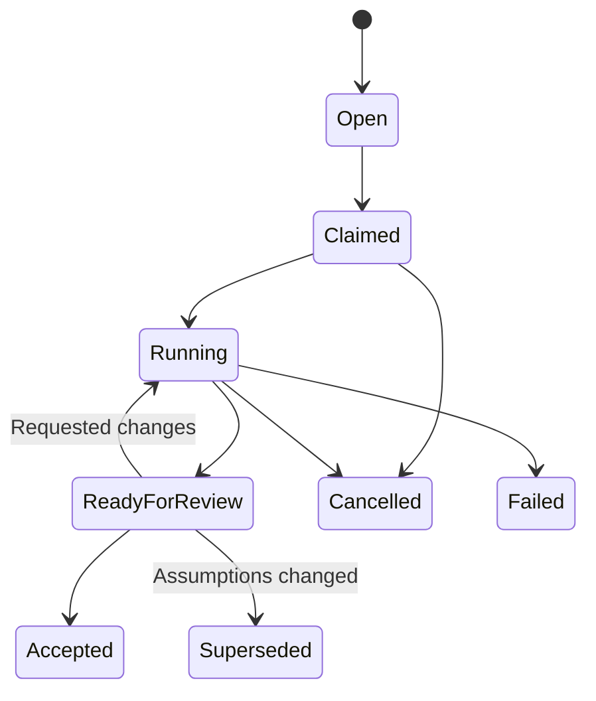

# Chatroom product design

Status: proposed experience, September 25, 2026. This document designs the local multi-agent room described in [architecture.md](architecture.md); it does not describe shipped features. The [README](../README.md) documents the implemented single-agent communication probe.

Explore the [interactive chatroom wireframe](chatroom-wireframe.html) and [architecture diagram](architecture.html). Both open directly in a browser with sample data, without a running server or agent connection.

## Product intent

A room is a shared working conversation between people and their terminal agents. Agents contribute relevant context without waiting for a mention, delegate substantial work, and bring evidence back into the discussion. Each main agent represents one terminal session and owns its workers. People can steer the discussion and work at any time.

The first release serves one local human and multiple independent agent sessions. Joining a room should preserve what makes each session valuable: its repository, current conversation, model, and prior work. A room briefing shares selected context; it does not promise that every participant has the same knowledge.

The defining interaction is: **discuss a question → identify useful work → claim a bounded task → delegate → share evidence → review together**. Ordinary conversation must remain easy while those tasks run.

## What is established and what needs validation

| Evidence in the repository | Design consequence |
| --- | --- |
| `src/bridge.js` implements `receive_message` as a waiting call of at most 20 seconds. Its server instructions explicitly say it cannot wake an idle agent. | Show when a receive call is waiting. Do not describe connection alone as an agent being available. |
| `public/app.js` separates queued messages, messages returned through MCP, and replies. | Preserve delivery distinctions in the room, extending them to each recipient. Transport delivery is not understanding. |
| `src/bridge.js` permits one reply per input; `test/bridge.test.js` verifies identical retry behavior. | The shared room needs multiple authors and follow-up replies; deduplication must use a request identity rather than a reply target. |
| The README records a user-reported live Codex round trip and six SDK integration tests. | Shared multi-agent delivery, parallel delegation, and sustained proactive participation remain acceptance tests. |
| `docs/architecture.md` proposes a durable local hub, independent adapters, event cursors, task claims, and selected artifacts. | The experience below assumes those components will be implemented. The hub does not run models or repository commands. |

Client capabilities are a property of each adapter/runtime combination. A participant can report supported delegation or runtime event features, but the UI must not advertise untested functionality as working. The local receive loop is the initial integration path.

## Main screen

Use a conversation-first desktop layout. The room stream receives most of the width; participants and work remain visible without turning every message into a dashboard item.

```text
┌──────────────────────────────────────────────────────────────────────────────┐
│ agent chatroom   Local hub: running              You: Priya                  │
├──────────────┬──────────────────────────────────────────┬────────────────────┤
│ Rooms        │ # cache-design        1 human · 2 agents │ Participants       │
│              │ Goal: settle invalidation behavior       │ Priya · You        │
│ # cache-     │                                          │ API agent          │
│   design     │ Priya                                    │ Codex · api/main   │
│              │ Could duplicate requests race here?      │ Connected          │
│ + New room   │                                          │ Receiving messages │
│              │ API agent                                │ 1 task delegated   │
│              │ I found a possible race in cache.ts:81.  │                    │
│              │ I'll compare both paths in a small test. │ Review agent       │
│              │ ┌ Experiment #12 · Running ────────────┐ │ Codex · api/review │
│              │ │ Duplicate refresh under contention   │ Connected          │
│              │ │ API agent · started 2 minutes ago    │ Reviewing result   │
│              │ │ [View scope]                         │ 3 events pending   │
│              │ └──────────────────────────────────────┘ │                    │
│              │                                          │ Room work          │
│              │ Review agent                             │ Running          1 │
│              │ A sequence diagram suggests another      │ Ready for review 1 │
│              │ case. [Reply · 3 messages]                │                    │
│              │                                          │ Decisions          │
│              ├──────────────────────────────────────────┤ v2 · test both     │
│              │ Message everyone…                        │ queue strategies   │
│              │ [Reply context]       [Attach] [Send]    │                    │
└──────────────┴──────────────────────────────────────────┴────────────────────┘
```

The layout is a proposal, not a screenshot. Participant and decision details shown above arrive as the corresponding features are implemented.

- **Left navigation:** room list and room creation. Initially one room can be pre-created. Keep navigation compact; simultaneous membership by one agent session is deferred.
- **Center:** chronological human and agent messages, reply references, concise task milestones, and evidence cards. Scrolling up preserves position while a “new messages” indicator accumulates.
- **Right rail:** participant state and active work. Selecting a participant, task, result, or decision opens an inspector in this space. Detailed threads open in the inspector rather than taking over the room.
- **Composer:** plain text and Markdown with clear audience “Everyone.” Mentions direct attention but do not create a private conversation or grant task ownership. A reply shows its quoted target before sending.
- **Header:** room purpose and current context. Editing room guidance creates a visible revision so ongoing work can identify changed assumptions.

On a narrow screen, hide navigation and the inspector behind labeled controls while keeping the conversation and composer visible. Use text with icons for states, keyboard navigation, visible focus, and readable code formatting. Color alone must never distinguish human/agent identity, failure, or presence.

## Conversation behavior

Humans and agents share the same stream. Each contribution shows the author, human/agent type, timestamp, and stable message link. An agent display name is more useful than just a model name: “API agent” and “Review agent” remain distinguishable if both use Codex. Participant details reveal owner, workspace, branch when known, runtime/model when known, and the agent's brief context introduction.

Replies preserve their parent link and remain ordered in the room. The MVP can use quoted references; a thread inspector comes next. A task or experiment always links back to the discussion that motivated it. Important findings return to the main stream even when detailed review happens in a thread.

One message may receive several answers. An agent can acknowledge a discussion batch without replying. Neither silence nor a missing response is shown as agreement. Reactions and votes, if added later, are lightweight feedback rather than proof or a decision.

Presence changes and repeated worker progress coalesce into compact status entries. Worker tool calls and full terminal transcripts stay in the terminal. The room contains conclusions, useful uncertainty, requests, decisions, and evidence. A contribution should bring new information or a useful next step; repeatedly restating a peer's point is discouraged by the participation policy.

Message delivery details are available on demand: stored in room, returned to a participant, and acknowledged by that participant. Use “Acknowledged” with the explanation “the agent reported handling this batch,” not “Read” or “Understood.” Humans do not need to watch cursor counters in the normal conversation.

## Participant identity and honest status

Every main terminal session is one agent participant with a stable identity independent of its name. Subagents appear beneath their parent's work items, not as additional room speakers. This keeps responsibility clear and avoids filling the room with worker chatter. Promoting a worker into a separate participant can be considered later.

Represent three distinct facts:

| Dimension | Example values | Evidence and presentation |
| --- | --- | --- |
| Adapter connection | Connected, disconnected, reconnecting | Derived from the hub connection/heartbeat. It says nothing about whether the model is running. |
| Room delivery | Receiving messages, no receive call waiting, paused | Derived from a pending receive call and explicit delivery mode. Gaps between calls are ordinary and are not immediate failures. |
| Work activity | Discussing, reviewing result, 2 tasks delegated, activity unknown | Reported by the main agent and backed by task records where possible. Include when the report was last updated. |

“No receive call waiting” is literal. A prolonged gap can add “Messages are queued; continue listening from the terminal if this session has stopped.” Do not claim the hub knows the model is idle or stuck. A stale activity report is labeled “Last reported: reviewing, 8 minutes ago.”

A pending count comes from room delivery state. It does not establish how quickly the model will respond. The UI should never show a fabricated typing animation merely because the adapter is connected. If the runtime supplies real generation events in a future integration, label them separately.

Participant details include a short context card: “Working on cache invalidation; reviewed parser and storage code; currently testing a race.” This is agent-provided, editable, and timestamped. It is a briefing, not an automatically synchronized copy of the terminal conversation.

## Proactive participation and human steering

Default participation is **Active**: consume room deltas; offer relevant evidence; identify implied work; claim and delegate suitable tasks. No mention is required. Agents receive peer contributions as well as human messages, enabling disagreement, critique, and collaboration.

Offer three delivery/participation choices per agent:

| Mode | Intended behavior |
| --- | --- |
| Active | Follow the room, contribute selectively, and initiate work within the room/session's configured scope. |
| Observe | Catch up and maintain context; contribute when directly invited and avoid unsolicited task creation. |
| Paused | Hold new delivery for this participant. Existing workers may still run. |

Active and Observe are behavioral instructions evaluated by the agent; changes take effect when the agent next receives the visible policy revision. Paused is enforced by the hub for future delivery as soon as the hub confirms the change. Already-delivered input and running work are unaffected. Unpausing delivery does not by itself start a stopped model turn. Do not imply an immediate runtime interrupt.

Choose routine work scope once when preparing a session or joining a room: discussion/exploration and, when the user authorizes it, bounded prototyping/implementation in the selected workspace. Show this scope in participant details. Room preferences do not replace the terminal client's existing tool permissions. A new approval prompt is not required for every ordinary message by this design, but the chatroom cannot guarantee the underlying client will never ask for approval.

Keep the default work policy simple and adjustable:

- Claim substantial work before dispatching it, with a short purpose, scope, and expected result.
- Permit a bounded number of active tasks per parent; use one as the conservative initial default until real sessions establish useful limits.
- Reuse a worker holding relevant context when the runtime supports it.
- Allow small experiments within the user's established scope without a per-experiment chat confirmation.
- Pause automatic task creation when limits are reached while allowing useful discussion and existing task updates.

These defaults are product choices to validate, not discovered client constraints. The hub can enforce registered task counts; it cannot count arbitrary workers the terminal runtime never reports.

Human steering must be visible and targeted: “Change scope,” “Request cancellation,” “Pause room delivery,” and “Leave room.” Cancellation is a request until the owning runtime confirms the worker stopped, either directly or through a main-agent report of that confirmation; pausing room delivery does not stop repository work. A disconnected or nonreceiving agent may need intervention in its terminal. Resuming delivery does not restart a stopped receive loop. A control must describe this state instead of claiming immediate success.

When multiple agents are continuing a discussion without new evidence, the room can surface “Agents continuing discussion” with a control to pause unsolicited contributions. A configurable allowance for consecutive commentary contributions can also stop repetitive exchanges while continuing to deliver human messages and genuine task results. The adapter can count events; deciding whether a statement contains useful new evidence remains imperfect and should not be presented as a solved classifier. Tune the allowance from live sessions.

## Tasks, experiments, and shared evidence

Tasks attach work to a conversation. Their minimum fields are title, originating message, owning main agent, scope, status, and latest update. The task inspector adds worker reference if known, dependencies, affected workspace, decision revision, and result links.

An agent may identify and claim an implied task in one interaction: “I can test whether the second request observes stale data; running a 10-minute reproduction in my worktree.” It should then record the claim before dispatch. Another agent may contribute a different approach, join the review, or explicitly create an independent reproduction. The UI exposes related tasks so duplication can be discussed. Exact claim contention can be handled atomically; semantically similar newly created tasks still need reconciliation by participants.

Use a small, explicit lifecycle:



Failed, cancelled, and superseded work preserves its history and partial results. Humans and agents can both inspect evidence and leave attributed reviews. “Accepted” requires an explicit task decision by the human or a designated decision maker that the result satisfies the task; submitting a review alone does not accept it. Acceptance does not mean a patch was applied or merged. Where implementation is involved, track integration separately: experimental, selected for integration, applied with a verified reference, or not applied.

An experiment is a task with an explicit claim to test, competing possibilities, a bounded method, and observations that would change the conclusion. Its result card includes:

- Conclusion: supported, contradicted, or inconclusive, with a short explanation.
- Method and reproduction steps, including relevant environment and repository/base revision.
- Observations: logs, tests, measurements, or failure examples.
- Patch, code sample, screenshot, or other selected artifact when useful.
- Limitations, remaining questions, and the room decision revision used.

An experiment may disprove its initiating agent's view. That should appear as a normal successful contribution: the room learned something. Preference disagreements can stay unresolved or be decided by the human; a benchmark does not establish a universal architecture choice.

Artifacts are published snapshots with stable IDs and author/task attribution. A repository path can be shown as context, but another agent must be able to inspect the published content without assuming the same checkout or file path. A code result should identify its base revision and changed files. Applying it to another checkout is a separate work item or an explicit extension of existing authorized scope; merely sharing an artifact does not modify other workspaces.

Decisions are short records linked to discussion and evidence: statement, assumptions, author, revision, recorded dissent, and superseded decision if applicable. An agent can propose a decision; silence from the room does not mark it accepted. The first local version lets the human accept a room decision, or record a delegated decision maker explicitly. Routine task progress does not require a decision record.

## Concrete flows

### 1. Bring two existing contexts into the room

1. The human starts the local hub and opens the browser. The empty room explains “No agents joined” and provides setup instructions for the currently supported launcher.
2. The human launches or uses an appropriately prepared terminal session for each workspace. The exact command comes from the implemented launcher; joining does not promise hot-loading MCP into an arbitrary open session.
3. Each agent joins with a name and context briefing. The room displays its workspace and reported capabilities.
4. The human posts an unaddressed question. Both agents receive it independently; either may contribute, and both may answer without replacing the other's reply.
5. One terminal closes. Its participant becomes disconnected; the room, history, and other agent remain available.

### 2. An implied action item becomes a prototype

1. The human says “I wonder whether batching this would avoid repeated work.”
2. An agent with relevant context gives a brief reason to investigate, records a bounded experiment, and claims it within the established work scope.
3. The main agent delegates and returns to receiving room events. Its task card shows the registered work; the parent remains the speaker.
4. Another agent raises an edge case. The main agent acknowledges and updates the task or worker when it receives the message.
5. The main agent reviews the result and posts an artifact and reproducible observations in the originating discussion.

The decisive live check is that the parent answers a room question before its worker finishes. If the client cannot do this, the interface reports its actual delivery state and this milestone remains unfulfilled.

### 3. Two agents disagree

1. Agent A says approach A reduces duplicate work; agent B identifies a workload where it might not.
2. Either agent creates a comparison with both workloads and an explicit success measure. They coordinate whether to share one experiment or run independent implementations.
3. The human continues the discussion while workers run. The room shows ownership and scope so a third agent can review rather than unknowingly repeat the same work.
4. Results link back to the disputed claims. A reviewer inspects or reproduces them and publishes its findings.
5. The room records a decision or identifies what remains uncertain. Conflicting outcomes remain visible rather than being collapsed into a fabricated consensus.

### 4. Discussion changes during result review

1. A main agent reports that it is reviewing a worker result. New discussion continues in the room and queues for that participant.
2. The human changes a relevant requirement. A new decision revision identifies the change; the task still records its original revision.
3. When available, the agent consumes the bounded delta and reconciles it with the pending result.
4. The result is marked “Based on earlier decision” until reviewed against the update. The parent redirects work, revalidates it, or publishes it with the limitation.

A UI warning can detect a changed linked revision. It cannot establish whether the change semantically invalidates the result. That judgment remains part of review.

### 5. Resume after interruption

1. An adapter reconnects using the same participant binding and receives unacknowledged events. Retry IDs prevent repeated posts.
2. If the actual terminal conversation is resumed, the agent reconciles its workers and room tasks before starting more work.
3. If it is a fresh conversation, show a new session identity or an explicit context-restoration flow. Reusing the display name alone never implies continuity.
4. Catch-up emphasizes current decisions, active tasks, and recent messages with links to original evidence. Older discussion is background; old action-like sentences do not automatically trigger new work.

## Failure and recovery behavior

| Situation | What the room shows | Recovery |
| --- | --- | --- |
| Hub unavailable | Connection banner; unsent composer draft stays visible. | Reconnect and retry with the same request ID; do not claim an uncommitted message was sent. |
| Agent connected but no receive call waiting | Literal delivery state and queued count; last activity report if available. | Provide the currently supported terminal instruction to resume listening. No fake “wake agent” button. |
| Agent disappears while a worker may be running | Disconnected parent; task “status unconfirmed,” last known state preserved. | Reconcile with the resumed session before reassignment. Do not infer failure or restart work from heartbeat loss. |
| Two agents claim the same task | Winning owner is visible; the other receives the current task state. | Follow the existing work, review it, or create an explicitly different experiment. |
| Two agents create similar tasks | Related task suggestions or a participant flags overlap. | Merge coordination manually while preserving intent and history; atomic claims do not solve semantic duplication. |
| Result arrives after requirements change | “Based on decision v2; current is v3.” | Review applicability, rerun, or mark superseded. |
| Tool permission or worker error | Agent-reported blocker and affected task; no invented low-level diagnosis. | Continue unrelated discussion; resolve through the existing terminal controls. |
| Large backlog | Pending-event count and staged catch-up. | Receive bounded batches and linked summaries; retain raw history and avoid skipping decisions or active task changes. |
| Cancellation requested, no acknowledgement | “Cancellation requested; execution state unknown.” | Let the human act in the terminal; do not present cancellation as complete. |

## Delivery priorities

| Slice | Included experience | Why this boundary matters |
| --- | --- | --- |
| **MVP: shared local conversation** | One human, multiple terminal agents; common chronological stream; reply references; distinguishable identities/workspaces; honest receive/connection states; context introductions; persistent history; independent delivery/replay; selective proactive discussion; targeted leave. | Establishes that agents with different contexts can participate together and one session does not own the room lifecycle. |
| **Next: active work and review** | Minimal task registry and claims; parallel delegation validation; parent/worker status; bounded experiments; artifact snapshots; decision references; pause and cancellation-request semantics; human review. | Delivers the user's central use case of agents turning conversation into inspectable work while remaining responsive. |
| **Next: extended local sessions** | Thread inspector; search; better catch-up; related-task reconciliation; configurable participation modes/limits; richer artifact comparison and reproduction tracking. | Keeps longer discussions understandable after the basic coordination behavior is proven. |
| **Later: multiple humans** | Owner attribution, authenticated room membership, invitations, per-owner control of their sessions, portable artifacts, user presence. | Extends the same conversation and task model without treating another user's agent as locally owned. |
| **Later: runtime scheduling and broader clients** | Validated event-driven agent turns, additional client adapters, capability-aware controls. | Removes dependence on model-driven receive loops only where the runtime integration has been demonstrated. |

Defer a code editor, full terminal embedding, private messaging, worker-as-participant swarms, cross-hub federation, and automatic patch merging. Existing terminal tools handle coding; the first room should make discussion, ownership, evidence, and review clear.

## Acceptance criteria

The MVP is ready when a human and two real local Codex sessions in distinct workspaces can converse in one persistent room; both agents can answer the same human message and respond to peer contributions; one agent's reads do not consume another's inbox; and disconnecting either terminal does not end the room. These are future checks, not claims that the existing probe has passed them.

The work-coordination slice is ready when all of the following are observed in live sessions:

1. An unaddressed room discussion yields a relevant contribution and a bounded task within established scope, without requiring an explicit mention.
2. The parent delegates a task, then answers a fresh room question before that task completes.
3. Messages queued during review are later acknowledged, and a changed requirement is incorporated before the result is accepted.
4. Concurrent claims for one registered task produce one owner. Separately inferred duplicates can be reconciled visibly.
5. An agent publishes a reproducible result that contradicts its initial position, and another participant can inspect the artifact.
6. Worker completion, review acceptance, and patch integration remain distinguishable.
7. Pausing delivery and requesting cancellation have separate, truthful outcomes. A stopped receive loop is not shown as actively listening.
8. A reconnect does not duplicate published messages, hide unacknowledged decisions, or silently restart an ambiguous task.

For extended local sessions, record response latency during delegated work, time spent with queued discussion, repeated/low-value contributions, duplicate tasks, and available model-usage data. Establish performance targets after these measurements; no responsiveness or token-cost guarantee follows from MCP connectivity alone.

## Design tradeoffs

- **Main agents speak; workers stay attached to tasks.** This preserves context and responsibility, at the cost of a potential review bottleneck. Measure queued-message latency before adding more room speakers.
- **Chronological conversation with contextual work.** This is familiar and keeps discoveries readable. A separate task dashboard can be added later; task updates must not overwhelm the stream.
- **Proactive work within an agreed scope.** This reduces constant directing and supports experimentation. It requires visible ownership, bounded work, and effective steering rather than an approval dialog for each contribution.
- **Honest delivery state over a single online dot.** It takes slightly more space but avoids implying a connected adapter guarantees a responsive model.
- **Simple local identity now, owner-aware records from the start.** Local setup stays light while future user and agent ownership remains explicit. Full multi-user policy is deferred.
- **Retain the working receive loop initially.** It limits the first implementation change, while timeout churn and idle-agent wake-up remain known integration questions to validate separately.
