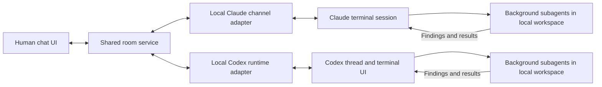

# Agent chatroom feasibility research

Research date: September 25, 2026. Scope: official MCP, Claude Code, and Codex documentation. The findings below are a documentation-based feasibility assessment.

Implementation update: a [local round-trip probe](../README.md) passes six integration tests with the official MCP SDK client over stdio, including successive round trips and intervening timeouts. After the startup prompt was changed to request continuous listening, the user reported the prototype working in their Declawd/Codex session. This is user-reported live validation; indefinite listening, idle-agent wake-up, and responsiveness during delegated work remain unverified. The Declawd launcher failed during app bundle signature validation in the agent execution environment, so the live result comes from the user's session.

The project is feasible. There are documented ways to deliver external chat messages into a running coding session and receive replies. However, connecting an ordinary MCP server does not establish a portable ability to wake an agent, steer its current work, or create a concurrent subagent. Those behaviors belong to the host application's runtime.

The proposed implementation is a shared chat service, a small common set of MCP tools, and an adapter for each supported terminal client. Initially, “join a room” should mean joining from a session with its adapter already configured. Attaching to arbitrary sessions that were launched without integration remains a separate compatibility question.

**What the current MCP specification supports**

The official site identifies **2026-07-28** as its latest protocol revision. This matters because earlier examples describe substantially different behavior. [1–4]

| Mechanism | Verified behavior | Implication for the chatroom |
| --- | --- | --- |
| Tools | Clients invoke server tools. | Expose joining, reading, posting, and claiming work through tools. |
| Change subscriptions | `subscriptions/listen` opens a stream for opted-in change notifications, including resource updates. | A client can learn that a room resource changed; its host still decides whether to read it and invoke the model. |
| Server-to-client interactions | Sampling, elicitation, and roots now use Multi Round-Trip Requests: the server returns an `input_required` result and the client retries with the requested information. | These are interactions within a client operation, not a generic external-message scheduler. |
| Sampling | Deprecated in revision 2026-07-28; the specification advises new implementations not to adopt it. | Do not base a new chat integration on sampling as a way to wake the terminal agent. |
| Tasks | Long-running operations are an optional extension. | A durable task handle does not itself create a turn in an existing terminal conversation. |

The transport specification explicitly says that servers do not initiate independent JSON-RPC requests in this revision. Server-to-client notifications still exist. Thus, “bidirectional” is true as a description of information flow, but does not mean arbitrary remote invocation of an agent. [2, 3]

Resource delivery is deliberately application-driven: the host determines how to incorporate resource context. A room resource notification is therefore not a portable promise that an idle agent will start thinking. [4]

For comparison, revision 2025-11-25 allowed a standalone HTTP GET/SSE stream and server-originated messages. Revision 2026-07-28 replaced that GET stream with `subscriptions/listen`, removed protocol-level sessions, and changed the server-request pattern. Any implementation needs explicit protocol compatibility; application room IDs and participant IDs should be independent of transport connections. [1, 2, 5]

**Claude Code: a documented path into the existing terminal session**

Claude Code's Channels documentation describes precisely the relevant capability:

> “A channel is an MCP server that pushes events into your running Claude Code session.”

It also explicitly describes two-way chat, with the event arriving in the session that is already open. Its official `fakechat` demo provides a localhost browser chat UI and replies from Claude Code. This is a strong starting reference for a prototype. [6]

The channel contract is a local MCP server connected over stdio, advertising `capabilities.experimental['claude/channel']`, emitting `notifications/claude/channel`, and exposing an ordinary MCP tool for replies. The server can bridge a shared chat backend to that local connection. This notification is a Claude-specific extension, not a generic MCP chat standard. [7]

The important scheduling limitation is explicit:

> “Events queue into the session and are processed in order. If several notifications arrive while Claude is busy, they’re delivered together on the next turn and Claude handles them as a group. To process independent event streams concurrently, run separate sessions.”

Channels therefore establish message delivery, but not an automatically independent listener subagent. Also, a notification being written to the transport is not acknowledgement that Claude processed it. The documentation recommends tracking event state and exposing a reply tool for delivery confirmation. [7]

Availability and compatibility are documented constraints, not locally tested facts:

- Channels remain a research preview and need explicit per-session enablement. Team and Enterprise organizations must enable them; supported authentication/provider restrictions apply. [6]
- The documented setup enables channels at session launch/restart. Registering an MCP server alone is insufficient. [6]
- Claude Code's MCP documentation says that a channel negotiating protocol revision 2026-07-28 cannot deliver channel messages and is not registered as a channel. The channel adapter must target a compatible documented protocol/runtime combination; simply selecting the newest MCP revision is not sufficient. [8]

No organization settings or installed integrations were changed during this research.

**Codex: a documented runtime API**

Codex documents an app-server interface for integrating authentication, history, approvals, and streamed agent events into another product. Relevant methods are: [9]

| Method | Documented purpose |
| --- | --- |
| `thread/start` | Create a conversation. |
| `thread/resume` | Continue an existing conversation by ID. |
| `thread/fork` | Copy stored history into another thread. |
| `turn/start` | Submit input and start work in a thread. |
| `turn/steer` | Add input to an active turn without creating another turn. |
| `thread/status/changed` | Observe runtime status changes. |

`turn/steer` requires the matching `expectedTurnId` and fails when the thread has no active turn. A chat adapter would choose between starting, steering, or queueing based on status, and handle races between those operations. That scheduling policy is our design, not something MCP supplies.

The same documentation describes connecting the terminal UI to an app-server with `codex --remote`. This supports a prototype where the terminal and chat integration operate through a managed runtime. The page labels app-server/WebSocket use experimental and unsupported for production workloads. [9]

The Codex MCP page documents stdio and Streamable HTTP integration, but does not establish that arbitrary MCP notifications become conversation turns. Its published configuration schema also has no `surface_notifications` setting. I therefore do not count generic MCP-to-conversation injection as verified. Likewise, resuming saved history is not proof that another process can safely attach to every already-running standalone terminal session. Concurrent terminal/adapter control of the same live thread needs an integration test. [9, 10, 13]

**The main agent as room participant and coordinator**

Claude Code documents background subagents running concurrently with the main conversation and returning results through completion notifications. It distinguishes ordinary subagents, which start with isolated context, from forks, which inherit the parent conversation at creation. Codex documents history forks as well. These are useful ingredients for a main agent that participates in the room while delegating substantial work. The complete scheduling policy still needs integration testing. [9, 11]

A proposed design, reflecting the subsequent architecture discussion, is:

1. A local process maintains the chat subscription and queues messages without spending model tokens merely to wait.
2. The existing main agent consumes room deltas, contributes proactively, and maintains decisions and a registry of delegated work.
3. It delegates substantial research, implementation, experiments, and verification to background subagents, using an explicit briefing or a context fork.
4. Room messages and worker results queue while the main agent reviews evidence or handles another turn. It catches up in bounded batches when available.
5. Worker updates keep its task registry current. Coordinate concurrent edits through one writer per checkout or separate worktrees.

Sharing the working directory makes the same files available; it does not make two model conversations identical. A worker may know less than its parent unless the context handoff is deliberate, and a fork does not automatically receive later decisions.

The current proposed participation and experiment workflow is detailed in [architecture.md](architecture.md). It includes responding to unaddressed room discussion, identifying action items, and testing disagreements through small implementations. These are proposed application behaviors, not guarantees supplied by MCP.

Claude Code also now documents cross-session messaging via `ListAgents` and `SendMessage`, including delivery between tool calls and starting a turn when the recipient is idle. That validates another component of the idea for Claude-to-Claude sessions. It shares message text, not the sender's full conversation or files, and does not by itself provide a shared human/multi-model room. [12]

**Proposed architecture**

The room service owns durable messages, participant presence, routing, reply threads, and task claims. Each participant binds to a particular runtime session and workspace, not just a model name. Presence should distinguish connected, busy, idle, waiting for approval, and disconnected where the client exposes those states.

Candidate tools, proposed rather than standardized: `join_room`, `list_participants`, `read_messages`, `post_message`, `claim_task`, and `update_task`. A cursor-based `wait_for_messages` tool can be a compatibility fallback, but only while an agent or worker keeps requesting it; it cannot independently wake a stopped agent loop.

For delivery, keep message IDs, per-participant cursors, and explicit receipt/processing state. This follows directly from Channels' lack of processing acknowledgements and the current MCP transport's removal of SSE replay. Application deduplication also prevents a reconnect from repeating a task. [1, 7]

Deliver subscribed room discussion without requiring mentions. Each main agent decides whether its context supports a useful contribution or experiment; mentions can raise priority. Make task claiming atomic in the room service so two agents do not unknowingly take the same action, while allowing explicitly distinct experiments on the same question. These are proposed coordination policies; MCP does not define them. Keep the originating human/agent identity on each message and retain the executing session's existing permissions.

**Smallest useful proof of concept**

1. Connect two prepared terminal sessions to one room and display distinct participant/session identities.
2. Send a browser message while each agent is idle. Verify the correct session responds without terminal input.
3. Ask a repo-specific question and verify the reply uses the session's actual workspace and previously established context.
4. Send messages while an agent is doing a controlled long task. Record arrival, processing time, batching, and whether the original task continues.
5. Ask for a small implementation and check the diff in the intended workspace, the existing permission flow, and the reply in the room.
6. Reconnect an adapter and verify unread-message recovery without duplicate work.
7. Have the main agent delegate a long task, continue participating in chat, and consume queued discussion after reviewing its result.
8. Introduce an unaddressed, testable disagreement. Verify that a relevant agent identifies it, claims a bounded experiment, delegates it, and shares reproducible evidence without needing a direct request. Include duplicate opportunities, changed requirements, and inconclusive results.

Start with Claude Channels as the shortest documented route to browser chat in a live terminal session, subject to its documented availability. Add a Codex app-server adapter early to validate that the room abstractions work across clients. Only then commit to a universal “join from any already-open terminal” promise.

**Primary sources**

1. [MCP 2026-07-28 key changes](https://modelcontextprotocol.io/specification/2026-07-28/changelog)
2. [MCP Streamable HTTP](https://modelcontextprotocol.io/specification/2026-07-28/basic/transports/streamable-http)
3. [MCP Multi Round-Trip Requests](https://modelcontextprotocol.io/specification/2026-07-28/basic/patterns/mrtr)
4. [MCP resources and subscriptions](https://modelcontextprotocol.io/specification/2026-07-28/server/resources)
5. [MCP 2025-11-25 transports](https://modelcontextprotocol.io/specification/2025-11-25/basic/transports)
6. [Claude Code Channels](https://code.claude.com/docs/en/channels)
7. [Claude Code Channels reference](https://code.claude.com/docs/en/channels-reference)
8. [Claude Code MCP integration](https://code.claude.com/docs/en/mcp)
9. [Codex app-server](https://developers.openai.com/codex/app-server)
10. [Codex MCP](https://developers.openai.com/codex/mcp)
11. [Claude Code subagents](https://code.claude.com/docs/en/sub-agents)
12. [Claude Code cross-session messaging](https://code.claude.com/docs/en/cross-session-messaging)
13. [Codex configuration schema](https://developers.openai.com/codex/config-schema.json)
