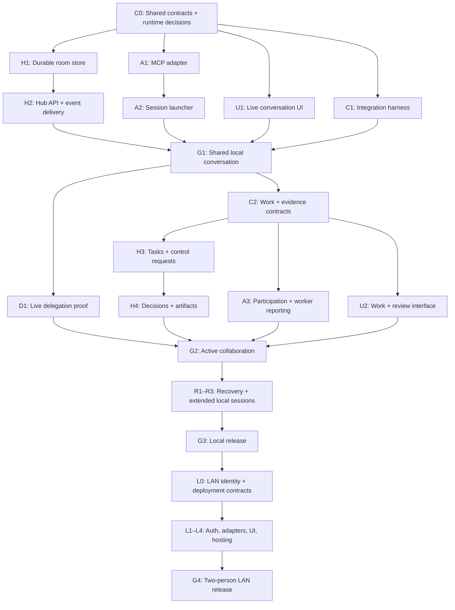

# Implementation backlog and parallel agent assignments

Status: proposed work, September 27, 2026. This document breaks down the [architecture](architecture.md) and [product design](chatroom-design.md) into assignable implementation tasks. It does not mark any of the new application features as implemented.

The IDs in this document are **milestone groups**. Actual Sol assignments are the smaller, dependency-bounded [agent work packets](agent-work-packets.md). Assign one packet at a time with fixed inputs, exact writable files, focused acceptance checks, and an explicit handoff. Do not assign an entire H1/H2/A3/U1 workstream as one task.

## Scope and starting point

The first release is a local application: one human, multiple channels, and multiple independent terminal agents. “Channel” in the interface and “room” in the protocol refer to the same entity. One agent session has one active channel initially; one hub can host several channels. Humans can switch channels in the browser.

The planned next release adds proactive delegated work, experiments, evidence, and review. Task reporting and initial invitation-based LAN access have since been implemented at the user's request; see the [current progress](progress.md) and [LAN contract](contracts/lan-v1.md). The broader packets below remain a roadmap, including live two-machine validation. Automatic idle-agent wake-up, simultaneous multi-channel agent participation, and additional model clients are separate integration projects.

Verified inputs to this breakdown:

- [src/bridge.js](../src/bridge.js) combines one HTTP server, one stdio MCP server, and in-memory message/reply arrays. It contains no shared hub, database, channel membership, or worker orchestration.
- [test/bridge.test.js](../test/bridge.test.js) defines six integration tests for the existing single-client probe. These are useful transport references; they do not verify multi-agent behavior.
- [package.json](../package.json) uses ESM JavaScript, Node `>=22.13.0`, MCP SDK 1.30.1, Zod 3.25.76, and Node’s test runner. The current test command discovers `test/*.test.js`.
- [scripts/codex.js](../scripts/codex.js) starts the probe in this repository. Workspace selection, shared-hub configuration, and durable session reconnect require new launcher work.
- [Chatroom wireframe](chatroom-wireframe.html) demonstrates the intended interface, including dark mode. Its messages, tasks, results, and controls are simulated.

Retain the probe and its tests while developing the new application alongside it. Use new hub and chat launcher commands initially; decide on replacing the old entry points after the local release passes its gates. Keep the HTML design previews as independent reference artifacts.

## Parallel execution model

Use **one coordinator and three implementation agents**. This fits four concurrent sessions and gives each working area a clear owner.

**Current model allocation:** the user approved **Astra (`gpt-6-astra`)** implementation after all three initially selected Sol workers disconnected twice. Astra handled the bounded hub, session/MCP and UI packets and integration review; the parent retained coordination, contracts and integration. At most three children run concurrently. Model selection does not change file ownership or acceptance criteria; the original Sol-sized packets remain the assignment boundaries.

| Lane | Responsibility | Exclusive implementation paths |
| --- | --- | --- |
| Coordinator | Contracts, shared dependencies, integration harness, cross-component review, release validation | `src/shared/**`, `test/helpers/**`, `test/contracts.test.js`, `test/integration*.test.js`, `package.json`, `package-lock.json`, release/runbook documents |
| Hub agent | Persistence, room API, delivery, task/decision/artifact services, later authentication | `src/hub/**`, `test/hub*.test.js`, `scripts/hub.js` |
| Session agent | MCP adapter, session binding, launchers, participation instructions, runtime integration | `src/mcp/**`, `src/runtime/**`, `scripts/chat.js`, `test/mcp*.test.js`, `test/runtime*.test.js` |
| UI agent | Browser application, channels, conversation, work inspectors, appearance, later invitations | `public/chatroom/**`, `test/ui*.test.js` and UI-specific fixtures |

These are proposed new paths. Serving `public/chatroom/` belongs to the hub; the UI agent owns its contents. Each implementation agent owns the tests in its lane. The coordinator owns the shared process harness and integration tests, rather than relying on a separate fifth agent.

Package and shared-contract changes go through the coordinator. A worker requests a change with the consumer use case and an example payload; it does not independently edit a shared schema or lockfile. Use separate worktrees when available, or the disjoint paths above in a shared checkout. Do not overwrite another agent’s edits. Hand over path ownership explicitly when reassigning a task.

Every handoff includes the implemented task IDs, changed paths, exported interfaces, validation commands/results, and remaining integration questions. Code against contract fixtures while another lane is unfinished; mark fixture mode clearly and remove it from the normal application path before release.

## Testing cadence and release evidence

Testing runs throughout implementation, triggered by meaningful changes and stable handoffs. The coordinator owns the combined result; an implementation agent's completion message or an Astra review does not substitute for executed checks.

| Checkpoint | Owner | What runs |
| --- | --- | --- |
| Before the first implementation wave | Coordinator | Run the existing probe suite and record the baseline. Establish isolated data directories, ports, process cleanup, and the supported browser/runtime environment in C1. |
| While a lane implements a meaningful behavior change | Implementing agent | Run its focused tests, covering observable behavior and relevant failures. Fix failures before handing off; avoid tests that only mirror the implementation. |
| At each task handoff | Coordinator | Review the diff and supplied evidence; run the affected contract/component tests and cross-component checks available at that point against a stable integrated snapshot. |
| After a shared contract or dependency changes | Coordinator + affected lanes | Validate the shared fixtures and affected real consumers. A mock accepting a payload does not prove that the hub and adapter agree on it. |
| When a complete user flow first connects | Coordinator | Run the real browser/hub/adapter path, with SDK clients where model reasoning is unnecessary; check UI behavior in an actual supported browser. |
| At G1, D1/G2, G3, and G4 | Coordinator with lane owners | Run the applicable automated release suite and the distinct live-session scenarios described below. Review outstanding failures and runtime limitations before declaring the gate met. |
| After a bug fix | Fix owner, then coordinator as needed | Reproduce the failure, verify the fix, and add a regression case for consequential behavior. Rerun affected checks; repeat wider suites only when the change or unresolved concerns justify it. |

The cadence is event-driven rather than a fixed timer. Test a known integrated snapshot instead of drawing conclusions from partially edited files while other agents are writing. Each worker still runs focused checks in its own lane while the rest of the application is under construction.

### What the different test layers establish

- **Component tests:** real persistence, room/member isolation, task transitions and claims, input validation, and retry/idempotency semantics.
- **Protocol integration:** a real hub subprocess and multiple actual stdio MCP adapters driven by the MCP SDK. Exercise timeouts, cancelled waits, independent cursors, duplicate/conflicting requests, process exit, restart, and replay without requiring model calls.
- **Browser end-to-end:** the actual webapp against the real hub, including send/receive, channel changes, multiple tabs, drafts during disconnection, status controls, dark mode, keyboard use, and mobile layouts. Fixture mode remains useful during development; it is not release evidence for the integrated path. DOM-only checks do not establish rendered appearance.
- **Live model sessions:** G1 uses two actual terminal agents plus the human browser. D1/G2 verifies that an unaddressed suggestion can lead to useful work, a parent can respond before its worker finishes, queued changes are reconciled, and another participant can inspect/reproduce the result. Assess observable behavior and evidence rather than exact wording of model replies.
- **Recovery and extended runs:** G3 exercises sustained discussion, backlog growth, restarts, ambiguous worker state, duplicate work, and measured response/usage behavior. G4 adds two actual machines, human ownership, LAN interruption, and revoked membership.

The live demos use bounded disposable workspaces or explicit worktrees, temporary room data, and clearly identified participants. They follow the normal client permissions. If browser automation or launching a real terminal client is unavailable in the agent execution environment, record that exact limitation and provide a repeatable local runbook; a passing SDK or DOM check must not silently stand in for the missing live check.

### Results and current status

For each handoff/release gate, record the task IDs, tested revision or working-tree snapshot, runtime versions, exact commands, pass/fail result, and whether the evidence came from fixtures, real protocol processes, an actual browser, or live models. Mark required checks as **not run**, **passed**, **failed**, or **blocked**, with the reason and next step for outstanding checks. Include useful failure logs and browser captures when available, without credentials or unrelated private terminal content.

Implementation status and test counts are tracked in [progress](progress.md). Automated tests now cover the original probe, shared contracts, actual repositories/services, separate MCP adapter processes and browser DOM composition against the real hub. Rendered browser/live-model checks remain pending, and delegated-worker/LAN features remain later milestones. [G1 validation](g1-validation.md) specifies the separate evidence required; fixture success does not establish those gates.

Baseline rechecked during planning on September 27, 2026: `npm test` passed all six existing probe tests, with zero failures. This result covers the current probe only.

## Dependency map

The graph expresses release dependencies. UI and adapter agents can implement against fixtures before the hub endpoints exist. Those tasks become integrated only after their real-client tests pass.

This is a proposed delivery order, not a protocol requirement. In particular, LAN identity/hosting work could move forward after G1 if multi-user access becomes the priority; it does not technically depend on the experiment dashboard. This plan schedules it after the local release to match the current local-first scope.

## Wave 0 — contracts before parallel implementation

### C0 — Define the shared protocol and module boundaries

**Owner:** coordinator. **Dependencies:** none. **Unblocks:** H1, A1, U1, C1.

- Create `src/shared/` schemas for owner, participant, connection instance, room, membership, event, message/reply, receive batch, acknowledgement, status snapshot, and structured errors.
- Define room API endpoints and the shared HTTP client interface. Include room create/list/join/leave, history pagination, message posting, bounded agent receives, acknowledgements, participant status, and browser event streaming.
- Make `room_id` explicit in room operations and event envelopes. Key processing progress by room membership, not a global participant cursor. Browser channel selection must not move an agent’s cursor.
- Specify idempotency: a stable author/request ID pair returns the original result for the same payload and rejects conflicting reuse. Multiple authors and follow-ups can reply to the same message.
- Specify delivery batch IDs, contiguous acknowledgements, filtered-event progress, replay, cancellation, and connection-generation fencing. Define pending-batch behavior on disconnect and room changes; choose one outstanding receive per membership for the first version.
- Separate browser stream reconnect positions and human unread/view state from agent processing acknowledgements. Multiple browser tabs represent the same human identity.
- Define local identity bootstrap, adapter binding, and who may change delivery settings. Derive the caller from the connection, not model-supplied author fields. Keep adapter credentials outside tool output and model prompts.
- Select the SQLite implementation after checking it against the declared Node version range and environment. Record the supported Node minimum, migration interface, persistence path, and dependency decision. Retain ESM JavaScript and Zod unless there is a documented reason to change.
- Publish valid/error/reconnect fixtures and a short API contract document. Include two channels and two agent identities so consumers cannot accidentally build around one global room or client.
- Implement the shared client itself and its Node/browser import path. Freeze repository/service seams, transaction ownership, injected clock/ID hooks, and shutdown contracts before their packet consumers start. C0.1–C0.3 in the packet catalog describe these coordinator deliverables.

**Done when:** schemas and examples validate; module exports, endpoint behavior, identity binding, version support, and error handling are sufficiently specified for each lane to start without inventing its own protocol. Shared fixture checks exercise the same schemas the real clients will use.

### C1 — Build the integration process harness

**Owner:** coordinator. **Dependencies:** C0. **Parallel with:** H1/H2, A1/A2, U1.

- Add helpers to launch a hub with a temporary data directory and OS-assigned port, connect multiple real MCP SDK clients, capture structured lifecycle events, and clean up every child process.
- Add controlled restart/disconnect scenarios and a schema-valid fixture server for adapter/UI development. Avoid fixed sleeps as the synchronization mechanism.
- Establish a browser end-to-end harness against the actual hub, selecting a runner that works in the supported development environment. Keep browser, protocol-only, and live-model execution separable so ordinary automated tests do not silently start model sessions.
- Wire agreed package scripts and dependency changes. Keep probe tests discoverable alongside new tests; account for the existing flat test glob if introducing directories.

**Done when:** the coordinator can run the same integration scenarios against the real assembled application; tests use isolated stores/ports and do not launch authenticated model sessions automatically.

## Wave 1 — shared local conversation

### H1 — Implement the durable room store

**Owner:** hub agent. **Dependencies:** C0.

- Implement migrations and repositories for owners, participants, workspace references, connection generations, rooms, memberships, ordered events, and acknowledgements.
- Assign per-room sequences and commit related records transactionally. Persist message request IDs and payload identity for replay-safe writes.
- Implement room/history queries, membership join positions, cursor advancement, stale-connection fencing, and channel isolation.
- Distinguish a resumed participant from a new conversation with the same display name. Treat connection liveness as ephemeral; do not resurrect stale online state after hub restart.

**Done when:** store tests verify restart durability, concurrent appends, independent room/member progress, duplicate/conflicting writes, invalid acknowledgements, and rejected operations from replaced connection instances.

### H2 — Implement the shared hub and delivery API

**Owner:** hub agent. **Dependencies:** H1. **Paths:** `src/hub/**`, `scripts/hub.js`.

- Run one standalone Node service. Serve the browser bundle, room APIs, participant snapshots, and HTTP/SSE browser events.
- Implement local owner bootstrap and session bindings from C0. Keep the initial service on loopback with configured Host/Origin validation and appropriate input limits.
- Implement independent bounded receives and explicit batch acknowledgement. Distinguish stored, returned, and acknowledged events; suppress self-echo without trapping the cursor.
- Make history/snapshot loading and stream subscription reconcile their sequence positions so an event arriving between them is neither lost nor rendered twice.
- Track adapter connection, receive-wait state, and timestamped reported activity separately. Expired activity becomes unknown/stale rather than an invented execution outcome.
- Clean up disconnected/aborted waits, reconnect streams from retained events, and shut down predictably. An adapter exit must not terminate the hub.

**Done when:** HTTP-level tests verify independent recipients, two-channel isolation, multiple replies, cancelled waits, stream catch-up, reconnect, truthful presence, and hub shutdown/restart behavior.

### A1 — Implement the per-session stdio MCP adapter

**Owner:** session agent. **Dependencies:** C0; integrate with H2 when ready.

- Implement `join_room`, `list_participants`, `read_history`, `receive_events`, `ack_events`, `post_message`, and `leave_room` using the shared client and schemas.
- Bind one terminal conversation/workspace to one participant and one active room. Keep stdout for MCP protocol output and diagnostics on stderr.
- Handle heartbeat, HTTP cancellation, bounded wait timeouts, reconnect, stale-generation rejection, and explicit fresh-session versus resume behavior.
- Preserve request IDs across transport retries. Do not acknowledge a batch just because it was returned through MCP; the main agent explicitly calls the acknowledgement tool.
- Surface recoverable errors to the agent with enough state to resume safely. An adapter cannot start an idle model turn by itself.

**Done when:** SDK tests connect two separate adapter subprocesses to the real hub, exercise all tools, replay unacknowledged events, and confirm that closing one adapter leaves the other and the hub working.

### A2 — Add the session launcher and participation setup

**Owner:** session agent. **Dependencies:** A1. **Path:** new `scripts/chat.js`.

- Add explicit hub URL, room, display name, and workspace options. Keep the adapter executable location separate from the repository working directory.
- Validate input, quote/serialize per-run MCP configuration correctly, and make a new session the default. Define an explicit resume path only where the actual client supports it.
- Add the initial participation prompt: join, introduce context, receive batches, contribute selectively without requiring mentions, acknowledge even when silent, and return to receiving after timeouts.
- Explain how a session already equipped with the adapter can join. Do not imply that the room can install MCP into an arbitrary running terminal conversation.
- Keep client permissions and managed settings unchanged. Use a fake spawned client to verify launch arguments and cwd; validate actual launcher compatibility separately in the supported environment.

**Done when:** two terminal sessions can be started against the same hub from different workspaces, with distinguishable identities; stop/leave affects the targeted session. Setup instructions distinguish new-session setup from joining through an already configured MCP integration.

### U1 — Build the real browser conversation interface

**Owner:** UI agent. **Dependencies:** C0; integrate with H2 when ready. **Path:** `public/chatroom/**`.

- Implement the wireframe’s shell as a real app: channel create/list/select, chronological conversation, human/agent attribution, reply references, participant context, composer, and reconnect banner.
- Bind the browser to the local human identity. Keep drafts and stream positions per channel and prevent late responses from a previously selected channel from entering the current view.
- Reconcile persisted history and SSE events by stable IDs. Preserve a stable request ID when retrying an uncertain send; do not display an uncommitted message as confirmed.
- Show connected/receiving/reported activity separately. Do not infer understanding from transport delivery or fabricate typing activity.
- Preserve dark/light preference, responsive layouts, visible keyboard focus, safe text rendering, and accessible labels from the preview.
- Expose implemented actions only. Work/evidence controls become live in U2; simulated agents or results must not appear in the normal application path.

**Done when:** real hub events render and compose correctly across two channels, two browser tabs, and reconnect. Theme and mobile controls work. Switching channels preserves draft/context boundaries and never acknowledges another participant’s delivery.

### G1 — Prove the shared local conversation

**Owner:** coordinator with all lane owners. **Dependencies:** H2, A2, U1, C1.

Automated integration scenarios:

1. A human and two independent adapters join channel A; both agents receive and reply to the same human message and receive peer contributions.
2. A separate channel B has independent history, membership, and delivery state. Non-members cannot receive its events or submit its room operations.
3. One agent reads/acknowledges while the other is offline; the offline agent later receives its own pending events.
4. A reply’s HTTP response is lost; retrying the same request produces one stored post.
5. Closing one terminal leaves the hub and the other agent working. Restarting the hub preserves history and acknowledged progress.
6. A stale connection cannot acknowledge or publish after a replacement resumes the same participant binding.

**Live gate:** two actual Codex/Declawd terminal sessions in distinct workspaces converse with a human and one another in the real browser. Record observations separately from SDK results. Do not label fixture replies as model validation.

## Wave 2 — active participation, delegated work, and evidence

### D1 — Validate main-agent responsiveness during delegation

**Owner:** coordinator, using session agent support. **Dependencies:** G1. **Parallel with:** C2 and work implementation.

- Run one bounded exploration in a subagent while its main agent keeps receiving room events.
- Send a new room question before the worker completes and observe whether the parent answers it.
- During parent result review, send a changed requirement; verify that the queued delta is consumed and reconciled before the result is presented as current.
- Measure actual behavior: receive timing, worker lifecycle, queued counts, timeout churn, and available model usage. Record capability differences instead of assuming every client behaves alike.

**Done when:** the chosen runtime demonstrates the required parent/worker concurrency, or the exact limitation and evidence are documented. If this fails, G2 remains unmet; evaluate X1 rather than promising concurrency through UI state alone. This experiment does not require the full task dashboard to exist.

### C2 — Define task, decision, artifact, and control contracts

**Owner:** coordinator. **Dependencies:** G1. **Unblocks:** H3/H4, A3, U2.

- Define task state/version, claim ownership, worker references, originating room/message, decision revision, failure/blocker reports, experiment observations, artifacts, reviews, and acceptance.
- Specify request-versus-confirmation semantics for pause, participation mode, cancellation, and worker status. Define permitted actors and operation authorization.
- Reserve an explicit control-delivery path so a paused participant can receive a resume/configuration response without consuming held conversation events; this still does not wake a stopped receive loop.
- Define bounded artifact transfer, content types/limits, storage IDs, and room membership checks. References carry origin-room identity so a result cannot silently move with the browser’s selected channel.
- Publish extension fixtures and compatibility expectations before the three lanes change their consumers.
- Freeze the actual runtime binding using D1 evidence before dispatching runtime-specific packets: main-agent tool reports and an external runtime API are different integrations. Specify which verified mechanism this release uses rather than leaving Sol to choose one during implementation.

**Done when:** all lanes agree on task transitions, review versus acceptance, cancellation confirmation, pause/resume delivery, stale-decision presentation, and artifact publication/error behavior.

### H3 — Implement tasks, claims, and control requests

**Owner:** hub agent. **Dependencies:** C2, H2.

- Implement create/claim/update task with transactional compare-and-set ownership and task/event commits.
- Support `open → claimed → running → ready_for_review → accepted`, plus failed/cancelled/superseded states and changes-requested returns to running.
- Persist targeted cancellation requests until runtime confirmation; do not infer cancellation or task failure from an offline parent.
- Implement delivery pause/resume, versioned participation settings, bounded work limits, and actual status reports. Agent-reported modes take effect on receipt; hub delivery pause has its own acknowledgement.
- Enforce the agreed contribution/concurrent-work budgets and expose repetitive-event coalescing or throttling. Preserve causation references so agent-to-agent reply loops can be diagnosed and bounded.
- Support related-work references so distinct experiments and possible duplicate tasks can be reviewed. An atomic claim only prevents duplicate ownership of the same registered task.

**Done when:** concurrent claims have one winner, invalid transitions are rejected, limits are enforced at the declared boundary, task/event state remains consistent after restart, and control requests never masquerade as confirmed execution changes.

### H4 — Implement decisions, artifacts, experiments, and reviews

**Owner:** hub agent. **Dependencies:** H3.

- Add attributed decision revisions with supporting event/artifact references and recorded dissent.
- Store selected artifact bytes/metadata under hub-owned IDs, including publisher, room, originating task, base revision, reproduction steps, observations, limitations, and conclusion.
- Support review comments and explicit task acceptance. Acceptance must not run repository commands or automatically apply patches.
- Handle missing/failed uploads and orphaned temporary content predictably; make artifact availability and event publication consistent.
- Render downloadable content through controlled content-type/disposition rules; never treat an arbitrary local path or untrusted HTML file as authorized executable content.

**Done when:** another participant can retrieve actual published content, trace it to its decision revision, and record a review. Membership checks apply to artifact access as well as messages. A published negative/inconclusive result is supported without inventing a successful experiment.

### A3 — Implement proactive participation and worker reporting

**Owner:** session agent. **Dependencies:** C2, A2; integrate with H3/H4. **Live capability dependency:** D1 for completion claims.

- Expose task/control/artifact tools and actual activity reporting through the adapter.
- Add participation instructions for relevant unsolicited contributions, bounded task proposals/claims, deliberate silence, duplicate-work coordination, and explicit delegation of substantial work.
- Avoid reflexive acknowledgements and repetitive peer replies; react to new information and respect the room's configured contribution budget. Validate this behavior in live multi-agent discussion rather than assuming a prompt guarantees it.
- Map work to actual runtime-supported subagent operations. The hub records work; it does not create a second model execution engine.
- Record task intent before dispatch; attach actual worker handles/status when available and reconcile uncertain dispatch after interruption. Do not blindly repeat an ambiguous implementation task.
- Brief workers with relevant context and decision revisions; pass updates explicitly, review outputs against new room events, and publish evidence into the originating room.
- Apply per-session work limits and respect existing execution permissions. Keep long tool transcripts in the terminal; publish concise findings and selected content.

**Done when:** a real session claims an implied task, delegates it, keeps participating as validated in D1, reports actual worker state, handles queued changes, and publishes reproducible evidence. Replay does not automatically launch the same task again.

### U2 — Implement tasks, evidence, decisions, and targeted controls

**Owner:** UI agent. **Dependencies:** C2, U1; integrate with H3/H4/A3.

- Add room task lists/cards and contextual inspectors for ownership, scope, worker state, blockers, experiments, artifacts, and reviews.
- Implement participant mode and delivery controls, pending cancellation requests, and confirmed/stale activity displays.
- Add attributed decisions and revision history; mark results linked to an older decision without claiming the change necessarily invalidates them.
- Provide evidence previews/downloads, review comments, and an explicit acceptance action. Keep review, acceptance, and integration distinct.
- Preserve conversation position and composer draft while inspecting work. Keep workers attached to parent-owned tasks rather than adding each worker as a room speaker.

**Done when:** the wireframe’s experiment → result → review → decision workflow is driven by actual API state and artifacts. Controls remain pending until the responsible component confirms them; no canned results remain in the live flow.

### G2 — Prove active collaboration

**Owner:** coordinator with all lane owners. **Dependencies:** D1, H4, A3, U2.

- Exercise an unaddressed human suggestion that leads to useful agent contribution and a claimed bounded experiment.
- Have a peer agent raise a counterexample, update the worker’s scope, publish a concrete result, and inspect/reproduce the evidence from another session.
- Cover a changed decision during result review, duplicate task claims, cancellation without runtime confirmation, participant pause with a worker still running, and a stale parent reconnect.
- Include a result that contradicts the initiating hypothesis. Verify that neither worker completion nor silent participants are treated as acceptance/consensus.

**Done when:** automated bookkeeping cases pass and the live conversation demonstrates the required proactive behavior. A model failing to notice one implied task is a recorded behavioral finding, not a reason to fake success in the interface.

## Wave 3 — reliable extended local sessions

| ID | Owner / dependencies | Implementation work | Acceptance evidence |
| --- | --- | --- | --- |
| **R1 — Hub recovery and query support** | Hub; G2 | Paginated history and searchable messages; bounded backlog queries; durable settings; task/artifact reconciliation; orderly store migration and restart; operational diagnostics without private transcript dumping. Freeze added endpoints with the coordinator before clients consume them. | Restart with pending events and ambiguous work retains recoverable state; pagination/search stay room-scoped; API load/backpressure does not silently lose events. |
| **R2 — Session recovery and catch-up** | Session; G2, R1 contract | Bounded batches and linked history retrieval; reconnect backoff; fresh-conversation briefing; reconcile prior tasks/workers; stale-context handling; explicit terminal instructions if the receive loop stopped. | Reconnect does not duplicate published work or pretend to restore unavailable model context; important decisions remain retrievable during large backlogs. |
| **R3 — Long-session usability** | UI; G2, R1 contract | Thread inspector, search, unread/catch-up navigation, room settings/work limits, connection recovery, accessible keyboard/mobile polish, and preserving drafts through disconnection. | Long histories remain usable; channel switching, stale-data banners, unsent drafts, and task inspection behave consistently during reconnect. |
| **G3 — Local release validation** | Coordinator; R1–R3 | Extended multi-agent run, fault/restart scenarios, supported-runtime checks, setup/runbook updates, review of measured latency/usage/duplicate work, and decision on the new default entry points. | Release notes separate automated coverage, live runtime observations, and unresolved limitations. No responsiveness or cost targets are claimed without measurement. |

Do not defer fundamental reconnect, persistence, or input validation to this wave: H1/H2/A1/U1 already cover the basics. This wave extends them to longer sessions and harder recovery cases.

## Wave 4 — another person and their agents on the LAN

One shared hub remains authoritative. A second person’s browser and local stdio MCP adapters connect to that hub over the network; their models and repository execution remain on their machine. This is a later application release, not a requirement for the first local room.

| ID | Owner / dependencies | Implementation work | Acceptance evidence |
| --- | --- | --- | --- |
| **L0 — Multi-user contracts** | Coordinator; G3 | Define authenticated owners, browser sessions, device/adapter enrollment, expiring invitations, membership roles, revocation, ownership of agent controls, and an explicit local-versus-LAN hosting configuration. Specify the secure transport/deployment approach against the intended environment. | Browser and MCP consumers share one authorization model; being on the same network or choosing a display name does not establish room access. |
| **L1 — Hub identity and authorization** | Hub; L0 | Implement invitation redemption, owner sessions, adapter enrollment, room authorization for reads/writes/streams/artifacts, control ownership checks, credential revocation, and persistence migration from the local owner. | Expired/reused invitations and revoked sessions are rejected; another owner cannot take over someone else’s agent controls; revoked membership closes or blocks continued delivery and artifact access. |
| **L2 — Remote hub connections from local adapters** | Session; L0 | Configure a network hub URL, authenticated device/session bindings, normal certificate verification, credential lifecycle outside prompts, reconnect across network loss, and portable artifact upload. | A real adapter on machine B joins the same room as machine A; workspace paths remain local metadata; reconnect preserves identity and pending events. Requires real-hub integration with L1. |
| **L3 — Invitation and ownership UI** | UI; L0 | Invite/join screens, multiple human identities, owner attribution on agents, membership management, expired-session feedback, and controls appropriate to the signed-in owner. | A second person joins with just a browser; adding their agent is optional; unauthorized controls are rejected by the hub even if a client attempts them. Integrate with L1. |
| **L4 — LAN hosting and operations** | Coordinator; L0, integrate with L1 | Package deliberate LAN hosting configuration, advertised URL and allowed origins, transport setup, data directory/backup/runbook, and clear host-unavailable behavior. Use network access permitted by the deployment environment. | Documented setup works without changing sandbox/managed-client controls; local mode remains available and does not silently expose itself to the LAN. |
| **G4 — Two-person LAN validation** | Coordinator; L1–L4 | Use two real machines, two humans, and their own terminal agents; exercise room isolation, artifact review, permission revocation, and host/network interruption. | Both humans and their agents collaborate in the same history, execution stays in the originating workspace, and loss of the host is reported honestly. Local multi-client tests alone do not satisfy this gate. |

## Separate extensions

| ID | Extension | Prerequisite and completion criterion |
| --- | --- | --- |
| **X1** | Runtime-driven scheduling / idle-agent wake-up | Investigate after G1 if D1 fails or timeout churn justifies it. Verify supported turn scheduling, steering, terminal coexistence, and thread ownership in the actual client before changing the adapter. Complete only when room events reliably start/steer the intended runtime without corrupting the user’s terminal session. |
| **X2** | One agent active in multiple channels | Build on G2 and existing membership cursors. Add explicit multi-room receive/post routing, fairness, per-room participation settings, task-origin handling, and context isolation. Complete when concurrent room backlogs and decisions cannot be confused or starve each other. |
| **X3** | Additional model/runtime clients | Build on G1; qualify each client’s MCP loading, receive-loop behavior, cancellation, and delegation separately. Use capability-aware UI and record unsupported features. A shared MCP schema alone does not establish matching runtime behavior. |

## First implementation dispatch

Complete C0.1–C0.3 and C1.1 from the [packet catalog](agent-work-packets.md), and establish the UI's C1.2 browser checks. The initial parallel assignments are then:

| Sol agent | Single assignment | Concrete boundary |
| --- | --- | --- |
| Hub | **H1.1 — Database lifecycle** | Open, migrate, reopen, and close the agreed store; no room API or delivery. |
| Session | **A1.1 — MCP shell and room tools** | SDK-tested stdio shell and join/list/history/leave wrappers using the supplied shared client/fixtures; no delivery or reconnection implementation. |
| UI | **U1.1 — Application shell and theme** | Responsive layout, empty/loading slots, dark mode, and keyboard controls; no live conversation/state management. |

The coordinator fills the packet's exact read/write paths, contract revision, fixtures, and verification commands before dispatch. After each handoff, run the affected checks, accept the packet or return a scoped fix, then assign the next ready packet. Do not batch the whole lane into a single Sol task.

G1 remains the first end-to-end milestone. Packet completion, real-component integration, and live-model validation are recorded separately. Work/evidence, recovery, and LAN groups are similarly decomposed in the packet catalog; their later contracts must be ready before assignment.
